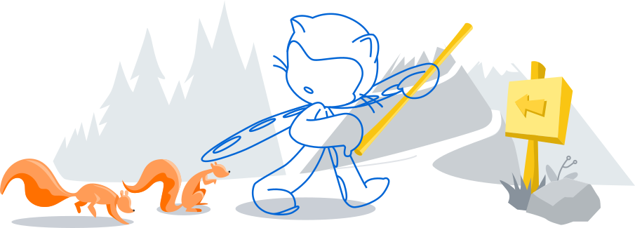
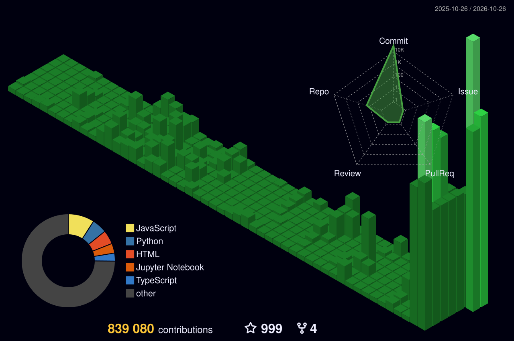
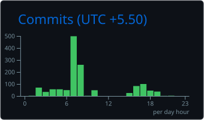
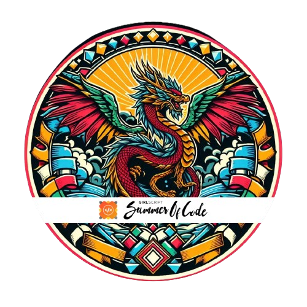

# Hey, I'm Brajesh Kumar 👋

> I build software at the intersection of **AI, full-stack engineering, and developer experience**. 
> I turn ideas into reliable products, intelligent systems, and digital experiences people actually use.

  

  &nbsp;&nbsp;
  &nbsp;&nbsp;
  &nbsp;&nbsp;
  

  &nbsp;&nbsp;
  &nbsp;&nbsp;
  &nbsp;&nbsp;
  

### What I Build

`AI Systems` · `Full-Stack Products` · `Developer Tools` · `Automation` · `Web Experiences`

    

## 👨🏻‍💻 About Me

### 🚀 Executive Summary

I work across **software engineering, AI/ML, DevOps, platform engineering, and automation**, building and improving systems from development to deployment. My work ranges from designing and shipping **full-stack applications and developer tools** to working with **AI/ML models, model training, LLM applications, and intelligent automation**. Beyond individual projects, I’m involved in **developer communities, technical initiatives, and product development**, where I work across engineering, infrastructure, and community building. I enjoy moving between different layers of technology, understanding how systems fit together, and turning ideas into practical solutions that can be built, deployed, and used in the real world.

<table width="100%">
  <tr>
    <td width="64%" valign="top">
      <h3>🛠️ What I Work On</h3>
      <ul>
        <li>🔭 I work across <strong>full-stack development, AI/ML, DevOps, platform engineering, and automation</strong>, often moving between application code, infrastructure, and the systems that connect them.</li>
        <li>🤖 On the AI side, I work with <strong>model training, LLM applications, RAG systems, and intelligent automation</strong>, focusing on practical and production-oriented use cases.</li>
        <li>🏗️ I build <strong>web applications, developer tools, automation workflows, and technical platforms</strong>, with an emphasis on reliable, maintainable, and practical software.</li>
        <li>🔄 I enjoy working across different layers of a system, from <strong>application development and APIs to infrastructure, deployment, and automation</strong>.</li>
      </ul>
    </td>
    <td width="36%" align="center" valign="middle">
      
    </td>
  </tr>
</table>

<table width="100%">
  <tr>
    <td width="36%" align="center" valign="middle">
      
    </td>
    <td width="64%" valign="top">
      <h3>🧩 How I Build</h3>
      <ul>
        <li>💡 I like turning rough ideas into <strong>clear, structured solutions</strong>, starting with the problem before jumping into implementation.</li>
        <li>🚀 My approach usually follows <strong>concept → architecture → implementation → deployment → iteration</strong>, adapting each stage to what the product actually needs.</li>
        <li>🎯 I care about the balance between <strong>good engineering, thoughtful design, and real-world utility</strong>. A technically strong product should also be understandable, usable, and useful.</li>
        <li>🤝 I’m open to collaborating on <strong>AI products, full-stack applications, developer tools, infrastructure, automation, and open-source projects</strong>.</li>
        <li>🌍 Outside of engineering, I enjoy <strong>exploring new places, riding, gaming, and working on creative ideas</strong>.</li>
      </ul>
    </td>
  </tr>
</table>

## 🏗️ Flagship Projects

*A selection of projects that represent the systems I build across AI, full-stack engineering, automation, and product development.*

| Project | What I Built | Key Technologies | Highlights |
|---|---|---|---|
| **[Bharat XR Platform](https://bharatxr.co/)** | Contributed to its XR web and platform ecosystem, alongside community initiatives. | XR · AR/VR · Web platforms | Spatial computing · Community programs · Platform initiatives |
| **[AgroTech AI](https://github.com/Brajesh31/Agro_tech_AI)** | Multi-service agriculture platform combining disease and crop APIs with an AI assistant, quiz app, and frontend. | React · Vite · Node.js · Express · MongoDB · Gemini API · Docker | Disease prediction · Crop rotation · Map experiences · OAuth · Docker Compose |
| **[Glaucoma Detection using Deep Learning & NSGA-II](https://github.com/Brajesh31/Glaucoma-Detection-NSGA)** | Retinal-image training and inference pipeline with CNN and transfer-learning support, NSGA-II hyperparameter search, and Grad-CAM++ visualizations. | Python · PyTorch · TorchVision · scikit-learn · DEAP · Flask | Fundus image classification · 5-fold cross-validation · NSGA-II search · Grad-CAM++ |
| **[Multi-Agent Observability with OpenTelemetry](https://github.com/Brajesh31/multi-agent-observability-opentelemetry)** | LangGraph multi-agent reference system instrumented to trace routing decisions, tool calls, latency, token usage, and failures. | Python · LangGraph · OpenTelemetry · OTLP | Agent-level traces · Custom metrics · Loop guardrails · Error attribution |
| **[Influencer Sponsor Coordination Platform](https://github.com/Brajesh31/Influencer-Sponsor-Coordination-Platform)** | Campaign app connecting sponsor and influencer accounts through dashboards, REST APIs, and scheduled ad-request checks. | Python · Flask · Flask-RESTful · Flask-SQLAlchemy · SQLite · APScheduler | Sponsor and influencer roles · Campaign workflows · Ad-request APIs · Scheduled checks |
| **[Arexa Website](https://arexa.co/)** | Built the Arexa XR studio website as a multi-page React application for its services, work, industries, case studies, and contact flows. | React · TypeScript · Vite · Tailwind CSS · Framer Motion | Animated route transitions · Responsive AR video carousel · Case-study and services routes · Page metadata and VideoObject schema |
| **[BharatXR Ambassador Portal](https://ambassador.bharatxr.co/)** | Built a full-stack ambassador platform with student and admin dashboards for onboarding, tasks, chapters, events, and community operations. | React · TypeScript · PHP · MySQL · PDO · REST APIs | PHP session authentication · Task and proof submissions · Admin review and analytics · Chapter, event, and finance workflows |
| **[AR Core Studio](https://github.com/Brajesh31/ar-core-studio)** | Built a browser-based AR viewer and admin portal for grouping Snap lenses and serving shareable AR experiences. | React · TypeScript · Snap Camera Kit · PHP · MySQL · Push2Web | Camera Kit lens carousel · Snap login and camera permissions · Group and lens management · Image/video capture with chunked uploads |
| **[Self-Healing Intrusion Detection System](https://github.com/Brajesh31/self-healing-ids-main)** | Built a Streamlit IDS prototype that runs bundled demo flows through XGBoost detection and decision-tree playbook selection, then visualizes simulated response actions. | Python · Streamlit · XGBoost · scikit-learn · pandas · joblib | XGBoost threat classification · Decision-tree playbook selection · Single-flow and 50-packet simulations · Session audit log and threat chart |
| **[Speech Emotion Detection](https://github.com/Brajesh31/emotion-detector)** | Built a Flask inference app that processes uploaded or recorded speech with 40-coefficient MFCC features and returns a label with model confidence. | Python · Flask · TensorFlow/Keras · Librosa · NumPy · joblib | Browser recording and audio uploads · MFCC preprocessing · Fixed-length pad/truncate pipeline · Saved-model inference with label decoding |

  

## ⏱️ Coding Activity

<table width="100%">
  <tr>
    <td width="60%" align="center" valign="middle">
      
    </td>
    <td width="40%" align="center" valign="middle">
      
    </td>
  </tr>
</table>

  <i>Tracking the hours behind the code.</i>

  

## 🧊 3D Contribution Map

<!-- 3D CONTRIBUTION MAP — generated by GitHub Action -->

  

 
### 📈 GitHub Stats

### 📊 GitHub Overview

<table width="100%">
  <tr>
    <td width="50%" align="center" valign="top">
  
</td>
    <td width="50%" align="center" valign="top">
      
    </td>
  </tr>
</table>

### 🏆 GitHub Trophies

  

### 💻 Language Statistics

<table width="100%">
  <tr>
    <td width="50%" align="center" valign="top">
      
    </td>
    <td width="50%" align="center" valign="top">
      
    </td>
  </tr>
</table>

### 📊 GitHub Insights

<table width="100%">
  <tr>
    <td width="50%" align="center" valign="top">
      
    </td>
    <td width="50%" align="center" valign="top">
      
    </td>
  </tr>
</table>

### 🔥 Contribution Activity

  

### 🛡️ Security & Achievements

<table width="100%">
  <tr>
    <td align="center" valign="middle">
      

        &nbsp;&nbsp;&nbsp;&nbsp;
         
        &nbsp;&nbsp;&nbsp;&nbsp;
         
        &nbsp;&nbsp;&nbsp;&nbsp;
      

      

        
      

    </td>
  </tr>
</table>

## 🎯 Expertise Areas

### 💻 Software Engineering

#### Programming Languages

&nbsp;&nbsp;&nbsp;&nbsp;&nbsp;&nbsp;&nbsp;&nbsp;&nbsp;&nbsp;&nbsp;&nbsp;&nbsp;&nbsp;&nbsp;&nbsp;&nbsp;&nbsp;

#### Frontend Engineering

&nbsp;&nbsp;&nbsp;&nbsp;&nbsp;&nbsp;&nbsp;&nbsp;&nbsp;&nbsp;&nbsp;&nbsp;&nbsp;&nbsp;&nbsp;&nbsp;&nbsp;&nbsp;&nbsp;&nbsp;&nbsp;&nbsp;

#### Backend &amp; API Engineering

&nbsp;&nbsp;&nbsp;&nbsp;&nbsp;&nbsp;

#### Databases

&nbsp;&nbsp;&nbsp;&nbsp;&nbsp;&nbsp;

### 🤖 AI &amp; Intelligent Systems

#### AI / Machine Learning

&nbsp;&nbsp;&nbsp;&nbsp;&nbsp;&nbsp;&nbsp;&nbsp;&nbsp;&nbsp;&nbsp;&nbsp;&nbsp;&nbsp;&nbsp;&nbsp;&nbsp;&nbsp;&nbsp;&nbsp;&nbsp;&nbsp;

#### Generative AI &amp; LLM

&nbsp;&nbsp;&nbsp;&nbsp;

### ☁️ Cloud &amp; Engineering

#### Cloud

&nbsp;&nbsp;&nbsp;&nbsp;&nbsp;&nbsp;

#### DevOps &amp; Infrastructure

&nbsp;&nbsp;&nbsp;&nbsp;

### 🧰 Development Tools

#### Developer Tools

&nbsp;&nbsp;&nbsp;&nbsp;&nbsp;&nbsp;&nbsp;&nbsp;&nbsp;&nbsp;&nbsp;&nbsp;&nbsp;&nbsp;&nbsp;&nbsp;

### Other

&nbsp;&nbsp;&nbsp;&nbsp;&nbsp;&nbsp;&nbsp;&nbsp;&nbsp;&nbsp;&nbsp;&nbsp;&nbsp;&nbsp;

## Random Developer Quote 💡 

> 

 

 

<table width="100%">
<tr>

<td align="center" width="50%">

<h2>🐾 Git Animals </h2>

</td>

<td align="center" width="50%">

<h2>🎮 TETRIS FUN </h2>

 
<strong>🎮 Play Tetris with Me!</strong> 
Watch the blocks stack!

🟦🟥🟩🟨🟪🟦🟨 
🟥🟩🟪🟦🟩🟨🟥 
🟩🟨🟥🟦🟪🟩🟦 
🟪🟦🟨🟥🟩🟦🟨 
🟦🟨🟪🟩🟥🟪🟩

Keep stacking and clearing lines! 🚀 
🎮 <strong>Play the real game here:</strong> 👉 <a href="https://play.tetris.com/play-now">https://play.tetris.com/play-now</a>

</td>

</tr>
</table>

 

## ❤️ Let's Get Connected

  &nbsp;&nbsp;
  &nbsp;&nbsp;
  &nbsp;&nbsp;
  &nbsp;&nbsp;
  &nbsp;&nbsp;
  &nbsp;&nbsp;
  &nbsp;&nbsp;
  

<!--   
 <h4 align="center">Wait!👋 don't forget to check out my social media handles </h4>

  <code></code>
  <code></code>  
  <code></code>

 
 
# 📊GitHub Stats :
 
 

## 🏆GitHub Trophies

---

-->

    

### 💡 Contribution & Open Source:
I contribute regularly to open-source projects and love collaborating with others on GitHub. Let's build something impactful!

  <picture>
   <source media="(prefers-color-scheme: dark)" srcset="https://raw.githubusercontent.com/Brajesh31/Brajesh31/main/output/github-contribution-grid-snake-dark.svg">
   <source media="(prefers-color-scheme: light)" srcset="https://raw.githubusercontent.com/Brajesh31/Brajesh31/main/output/github-contribution-grid-snake.svg">
   
</picture>

    © 2021 Brajesh Kumar

  

